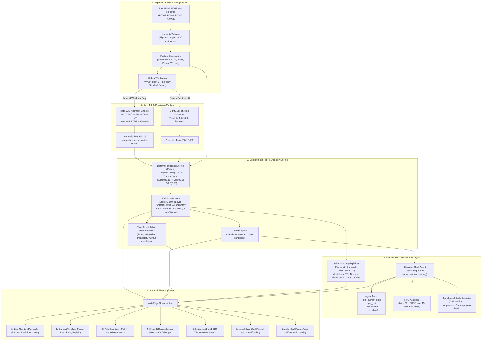

# System Architecture — AI Battery Safety Guardian

> **Designation:** Safety-critical decision support prototype for Lithium-Ion Battery Energy Storage and Electric Vehicle systems.  
> **Core Non-Negotiable:** *Decision-support prototype only. Strictly advisory; zero direct BMS or vehicle control actuation.*

---

## 1. System Overview & Problem Statement

Lithium-ion batteries in high-demand environments (EVs, grid storage) are subject to chemical and thermal degradation that can escalate into irreversible catastrophic events (thermal runaway). Traditional Battery Management Systems (BMS) rely on static, scalar threshold rules (e.g., $T > 55^\circ\text{C}$ or $V < 2.5\text{V}$), which often trigger too late to avert thermal propagation or produce excessive false alarms during high-load transients.

The **AI Battery Safety Guardian** introduces an end-to-end, multi-layered intelligence architecture:
1. **Unsupervised Anomaly Detection ($\beta$-VAE):** Learns the normal multivariate operational manifold from healthy cycling and flags early anomalous drift before physical safety thresholds are breached.
2. **Supervised Multi-Step Thermal Prediction (LightGBM):** Predicts cell temperature $T_{t+10}$ into the future, anticipating thermal accumulation.
3. **Deterministic, Auditable Risk Engine:** Pure Python arithmetic combining temperature, heating rate ($dT/dt$), current, voltage, and anomaly score into an objective 0–100 Risk Score.
4. **Debounced Event Management & Prescriptive Recommendations:** Filters transient spikes and pairs each event with auditable, rule-based mitigation actions.
5. **Grounded Generative AI & Tool-Calling Assistant:** RAG retrieval over domain literature, AST-sandboxed code execution with automated repair, and fine-tuned explanation synthesis.

---

## 2. End-to-End System Architecture

---

## 3. Subsystem Breakdown

### 3.1 Telemetry Pipeline (`src/guardian/data/`)
- **Ingestion (`ingest.py`):** Parses NASA battery `.mat` files spanning charge, discharge, and impedance cycles.
- **Cleaning & Validation (`clean.py`):** Enforces physical constraints ($2.0\text{V} \le V \le 4.5\text{V}$, $-10\text{A} \le I \le 10\text{A}$, $0^\circ\text{C} \le T \le 80^\circ\text{C}$). Derives Coulomb-counted SOC bounded in $[0, 100]\%$.
- **Feature Engineering (`features.py`):** Calculates 12 core dynamic features:
  1. `temp_c` (cell bulk temperature)
  2. `voltage_v` (terminal voltage)
  3. `current_a` (load current)
  4. `soc_pct` (state of charge)
  5. `temp_rate_c_s` ($dT/dt$)
  6. `volt_rate_v_s` ($dV/dt$)
  7. `curr_rate_a_s` ($dI/dt$)
  8. `power_w` ($V \cdot I$)
  9. `resistive_heat_w` ($I^2$)
  10. `v_times_soc`
  11. `temp_times_curr`
  12. `impedance_proxy` ($|dV/dI|$)
- **Splits & Windowing (`windows.py`):** Fits standard scalers strictly on training batteries (`B0005`, `B0006`, `B0007`) to prevent data leakage into held-out test battery (`B0018`).

### 3.2 Unsupervised Anomaly Detection (`src/guardian/models/vae.py`)
- **Architecture:** MLP $\beta$-Variational Autoencoder ($W \times F = 30 \times 12 = 360$ flattened inputs $\rightarrow$ 128 $\rightarrow$ 64 $\rightarrow$ latent $z \in \mathbb{R}^8 \rightarrow$ 64 $\rightarrow$ 128 $\rightarrow$ 360).
- **Formulation:** $\mathcal{L}_{\text{ELBO}} = \text{MSE}(x, \hat{x}) + \beta \cdot D_{\text{KL}}(q_\phi(z|x) \parallel p(z))$ with $\beta = 0.5$.
- **Calibration:** Mean squared reconstruction errors mapped to an empirical cumulative distribution function (ECDF) over healthy validation cycles:
  $$\text{AnomalyScore}(x) = \text{ECDF}(\text{MSE}(x, \hat{x})) \in [0, 1]$$
- **Feature Attribution:** Reconstruction error decomposed per feature channel to provide explainable root-cause bar charts.

### 3.3 Supervised Thermal Forecaster (`src/guardian/models/temperature.py`)
- **Architecture:** LightGBM gradient boosted regressor trained to forecast $T_{t+10}$ (10 time steps ahead).
- **Features:** Telemetry features at time $t$ plus lag features ($t-1, t-5, t-10$).
- **Performance:** Achieves MAE $= 0.0941^\circ\text{C}$ on held-out test battery $B0018$, substantially beating persistence baseline ($0.1587^\circ\text{C}$) and linear regression ($0.1246^\circ\text{C}$).

### 3.4 Deterministic Risk Engine (`src/guardian/risk/engine.py`)
Pure, deterministic Python function evaluating 5 weighted safety components:
$$\text{RiskScore} = 100 \times \left( 0.30 \cdot C_{\text{temp}} + 0.20 \cdot C_{\text{trend}} + 0.15 \cdot C_{\text{curr}} + 0.10 \cdot C_{\text{volt}} + 0.25 \cdot C_{\text{anomaly}} \right)$$

- **Threshold Bands:**
  - $0 \le \text{Score} < 30$: `NORMAL`
  - $30 \le \text{Score} < 55$: `WARNING`
  - $55 \le \text{Score} < 75$: `HIGH`
  - $\text{Score} \ge 75$: `CRITICAL`
- **Hard Safety Overrides:**
  - If $T \ge 50^\circ\text{C} \implies$ Immediately forced to `CRITICAL`.
  - If $T \ge 42^\circ\text{C}$ or $V \notin [2.5\text{V}, 4.25\text{V}] \implies$ Forced to at least `HIGH`.

### 3.5 Event Engine & Action Recommender (`src/guardian/risk/`)
- **Event Debouncing (`events.py`):** Enforces a minimum 15-second gap between consecutive events of the same severity to eliminate alert jitter.
- **Rule-Based Recommendations (`recommend.py`):** Deterministic lookup mapping risk levels and primary contributing factors to safe operational actions. Every output strictly concludes with:  
  *"⚠️ Decision-support prototype. Not for vehicle control. Escalate to human engineer."*

### 3.6 Guardrailed Generative AI Layer (`src/guardian/genai/`)
- **Explanation Validator (`validator.py`):** Validates generated JSON outputs across 5 programmatic checks:
  1. Strict JSON schema conformance.
  2. Numeric fidelity: Every number in the explanation must match the input JSON within $\pm 0.1$ or $1\%$.
  3. Risk level consistency: Mentioned severity must match assessment level exactly.
  4. Forbidden control verbs: Rejects any command instructing autonomous vehicular or BMS actuation (e.g., *"shut down the vehicle"*, *"cut power"*).
  5. Citation validity: Verifies every cited chunk exists in the retrieved set.
- **RAG Knowledge Assistant (`rag.py`):** 15 curated technical documents chunked into 52 passages, embedded with `all-MiniLM-L6-v2`, and indexed in FAISS with Hit@4 $= 100\%$.
- **Sandboxed Code Execution (`codeexec.py`):**
  - Static AST analysis rejecting `import`, dunder `__`, `eval`, `exec`, OS, network, and file system primitives.
  - Isolated subprocess execution with a 5-second timeout.
  - Automated 3-attempt healing loop using `heal_codegen_v1` on exceptions or KeyErrors.
- **LoRA Safety Explainer (`src/guardian/models/lora_explainer.py`):**
  - PEFT LoRA adapter ($r=16, \alpha=32$) fine-tuned on structured battery assessment pairs.

---

## 4. Hardware Compatibility & Offline Reliability

| Dimension | Strategy |
| :--- | :--- |
| **CPU-Only Execution** | All models (VAE, LightGBM, GAN, DistilBERT, LoRA smoke) are CPU-optimized and run without requiring a CUDA GPU. |
| **Offline Resilience** | If `GROQ_API_KEY` is not present, `LLMClient` falls back to deterministic template generation (`template_explanation`), ensuring zero UI crashes. |
| **Pre-baked Golden Session** | `data/golden_session.json` allows complete zero-network demonstration of all 7 dashboard pages. |
| **Memory Isolation** | Sandboxed code execution runs in temporary scratch directories with sanitized sub-environments. |

---

## 5. Security & Safety Invariants

1. **Advisory Decision Support:** No software component produces control outputs directly to vehicle actuators or battery contactors.
2. **Determinism at the Core:** The risk score is 100% computed in deterministic Python; LLMs only summarize, explain, and retrieve.
3. **AST Safety Checks:** User queries translated to pandas code are statically checked before Python AST execution.
4. **Self-Correction Audit Trail:** Every recovery attempt is logged to `reports/autoheal/log.jsonl` with full error taxonomies.
